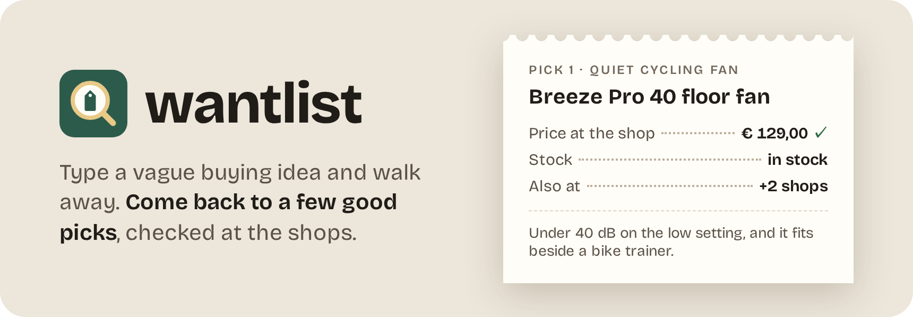

<h1 align="center">
  
</h1>

<p align="center">
  A self-hosted shopping researcher for Belgium that works while you don't.
</p>

<p align="center">
  <a href="https://github.com/ackervekenbm/wantlist/actions/workflows/ci.yml"></a>
  <a href="https://github.com/ackervekenbm/wantlist/actions/workflows/docker-build.yml"></a>
  <a href="https://github.com/ackervekenbm/wantlist/pkgs/container/wantlist"></a>
</p>

You know you need *something*: a quiet fan for the bike trainer, cozy slippers,
a citrus press that's easy to clean. You don't want to spend an evening
comparing webshops. Type the idea into wantlist, maybe with a budget, and walk
away. A background researcher searches the Belgian market, reads the product
pages and checks every offer at the shop. When you come back there are 3–5
picks waiting, each with a real price, stock, a photo, why it fits and one
honest caveat.

It runs in one small container on a Raspberry Pi or any other always-on box,
on free API tiers: €0 a month.

## Highlights

- ✍️ **Capture in one line.** A vague idea is enough. Add a budget and a must-have or two if you like.
- 🔎 **Researched in the background.** It plans searches, shortlists real products from the results and verifies them against the shop pages, while you do something else.
- 🇧🇪 **Shops you can actually order from.** Belgian shops and Dutch shops that deliver to Belgium, big marketplaces and specialists alike. No trade-only wholesalers, no import resellers, no far-away shops for everyday things.
- 💶 **Prices you can trust.** Every offer is opened at the shop: price and stock come from the shop itself, dead links are dropped, and sold-out products make way for ones you can buy.
- 👍 **React, then refine.** Mark each pick *No way*, *Kind of* or *Yes*, say why not, and the next round learns from it.
- 🧾 **Preferences you can see.** What the researcher understood (must-haves, things to avoid, things you like) is written out, and you can edit it.
- 🎯 **Hunt the exact thing.** Know exactly what to buy? Switch the idea to *Hunt* and it finds the cheapest real offer for that product, ranked by what you pay delivered. Refills come back with one tap.
- 🤝 **Your discount partners count.** Use a bill-discount program like Viking Deals? Partner shops show what you pay after it, with a link that makes the purchase count.
- 🛒 **Wanted, bought, archived.** *I bought this* keeps what you paid and where; only the wanted list is researched.
- 🔒 **Yours.** One SQLite file on your own server, no accounts, no tracking. API keys stay on the server.

## Quick start

You need **Docker** and two free API keys, no credit card for either:
**Gemini** ([get a key](https://aistudio.google.com/apikey)) for the reasoning
and **Serper** ([get a key](https://serper.dev), 2,500 search credits that
last months of personal use) for the searches.

```bash
docker run -d --name wantlist -p 8091:3000 -v wantlist-data:/app/data \
  -e GEMINI_API_KEY=your-gemini-key -e SERPER_API_KEY=your-serper-key \
  --log-driver json-file --log-opt max-size=10m --log-opt max-file=3 \
  --restart unless-stopped ghcr.io/ackervekenbm/wantlist:latest
```

Open <http://localhost:8091> and add your first idea. The image is public and
built for `amd64` and `arm64`, so any 64-bit OS works, a Raspberry Pi
included. For Docker Compose and OpenMediaVault, see [Deployment](#deployment).

## Features in detail

<details>
<summary><strong>Capturing and editing ideas</strong></summary>

- **Enter** adds the idea, **Shift+Enter** starts a new line. **+ budget & must-haves** adds a ceiling in euro and the constraints that matter ("quiet, white, fits a small flat"); both steer every step of the research.
- The researcher gives each idea a short title. Rename it any time, or clear the name to hand it back. Your own words stay underneath.
- **Edit** changes the text, budget, notes or preferences. Rewording the idea starts it fresh: the learned preferences go, and only the picks you said no to still count against repeats.

</details>

<details>
<summary><strong>Picks, reactions and refine rounds</strong></summary>

- Picks come one card at a time, with dots to jump between them. React with **No way** (and say why not), **Kind of** or **Yes**; tap the active one again to clear it.
- **Refine** researches a new round from your reactions and preference edits. **Research again** runs another round without them.
- Each round adds its own picks; earlier rounds fold away and are never deleted, so a failed round loses nothing. **Keepers** keeps your *Yes* picks in view.
- A product you've already seen never comes back, at any shop. When a round finds nothing new, it says so and suggests loosening a criterion or rewording the idea.

</details>

<details>
<summary><strong>Prices, shops and the caveat</strong></summary>

- Every offer's page is opened. When the shop publishes product data (most do), price and stock come from the shop itself and the price is marked ✓; a price only seen in search shows as "≈".
- One product at several shops is one pick: **+2 shops** lists the other offers, cheapest in-stock offer first. Picks over your budget are flagged.
- Known brands with real reviews rank above anonymous marketplace products, without excluding them.
- Each pick carries one honest caveat, the thing to check before you buy ("loud on the top setting", "check size 36 is in stock").
- **Discount partners (optional).** If you use a program that gives part of a purchase back on a bill, like Mobile Vikings' *Viking Deals*, turn it on with `PARTNER_PROGRAMS` (see the [settings](docs/deployment.md#settings)). An offer at a partner shop then says "≈ € 126,42 after Viking Deals · 2% back" (with a range when the rate depends on what you buy), and **Open via Viking Deals** starts the purchase on the partner page, which is what makes it count. Hunts rank offers on the price after the discount, so a partner wins a near-tie. The shop price stays the headline.

</details>

<details>
<summary><strong>Hunting an exact product</strong></summary>

- Every idea is in **Explore** (3–5 different products) or **Hunt** (one exact product, the cheapest offer). The first run guesses which from your text; the **Explore / Hunt** switch at the top of an idea overrules it. **Hunt this one** on a pick turns the idea into a hunt for that product, and your Explore rounds stay reachable. The shop that pick came from is always checked again, and a shop whose page can't be read (some block automated visits) is still listed, with a note to check it yourself.
- A hunt has a **target**: product, variant, condition (new, refurbished, used or any) and what doesn't count ("not Optimum"). It's drafted for you and editable.
- Offers are ranked by **what you pay delivered**: item price plus delivery. A delivery cost the shop doesn't state is never guessed: it says "delivery not shown". When pack sizes differ, offers compare **per unit** (per vial, per kg).
- The best offer gets a slip with a **Bought here** button; the other shops are listed below it. Pick-up only, no delivery to Belgium and "not the exact product" offers sit in folded groups, never on top. There's no reacting to offers: a hunt reads like a quote.
- **Bought here** records what you paid and asks "Will you buy this again?". Yes: the hunt is *covered* and waits in the **Pantry** (on the home screen and in the lists). No: it moves to Bought. Every purchase is kept, so the next slip can say "9% less than last time".
- **Running low** on a covered hunt starts a new hunt in the background. Nothing is ever watched or re-hunted on its own.

</details>

<details>
<summary><strong>How the research works</strong></summary>

1. **Plan.** A model turns your idea, budget and must-haves into a few search queries (in Dutch, like the shops), a title and your preferences. From the second round it first learns from your reactions.
2. **Search.** Serper runs the queries on Google with Belgium as the region. Category and search pages are dropped, and so is everything you've already seen.
3. **Shortlist.** A model picks 3–5 products, and it can only use links that came back from the search.
4. **Verify.** The server reads the top product pages, and a model keeps only what the evidence supports, with the why and the caveat.
5. **Check the offers.** Every remaining shop link is opened once for liveness, price, stock, photo and rating.

A hunt runs a variant of this: it plans queries for shops that sell exactly the target, opens up to 10 offer pages (and, when one is a comparison site, the shop page it links to instead), has a model read match, pack size, condition and delivery from each page, and ranks the offers in code by delivered price. It doesn't skip products you've seen, since finding the same shops again with today's prices is the point.

The models run on free tiers, so wantlist routes around their limits: several Gemini models (each with its own quota) and optional Groq or OpenRouter keys form a chain. A model that runs out sits out until its reset and the next one answers; when all of them are out, ideas wait instead of failing. Anything that needs you, like a missing key or spent search credits, says so on the idea.

</details>

<details>
<summary><strong>Phone and desktop</strong></summary>

The home screen sorts ideas into *Needs you* (picks to react to, a hunt's best offer, nothing new found, stopped), *With the researcher*, and the *Pantry* of covered hunts with their **Running low** buttons. On a phone you see one screen at a time; from 900 px wide, the list and the open idea sit side by side. Light, dark or system theme is one tap in the top bar, and a removed idea can be undone for a few seconds.

</details>

## Where your data lives

Everything is in one SQLite file on your server (`/app/data/wantlist.db` in the
container): your ideas, budgets, notes, preferences, reactions, picks, hunt targets and offers, and
every purchase (what you paid, where, per unit). API keys live only in the server's environment, never in the
browser or the database. The browser keeps only your theme choice.
With a discount partner program turned on, the server also downloads that program's public partner list once a day and keeps it in memory; nothing about you is sent.

There is **no login**, so keep wantlist on your home network or tailnet, and
never forward a port to it from the internet.

## Deployment

One container serves the app, the API and the research worker; it needs to
stay on, because research happens while you're away. The guide in
[docs/deployment.md](docs/deployment.md) covers:

- **OpenMediaVault** with its Compose plugin (the reference setup)
- **Docker Compose** with the repo's [`docker-compose.yml`](docker-compose.yml) and a `.env` (copy [`.env.example`](.env.example))
- every setting (model chain, fallback keys, worker timing), updating, backups, HTTPS behind a reverse proxy, and troubleshooting

## Development

You need Node 22 or newer.

```bash
npm install
cp .env.example .env        # add GEMINI_API_KEY and SERPER_API_KEY
npm run dev                 # API on :3091, UI on :5174 (open this one)
```

```bash
npm run build               # type-check, lint, client build, server build
npm test                    # unit tests; no network, no keys needed
npm run spike "your idea"   # run the research engine against your keys, step by step
```

`npm run spike` prints every step, the brief and the picks without the UI: the
fastest way to judge research quality.

<details>
<summary><strong>Project structure</strong></summary>

```
src/
├── client/          React UI (the "Quote Slip" design): screens, components, hooks
├── server/          Express API, SQLite store, background worker
│   ├── research/    the research pipeline, model providers, search, shop-page reading
│   └── partners/    bill-discount partner programs (Viking Deals)
└── types/           types shared by client and server
scripts/             the research spike and the README banner
docs/                deployment guide, research design notes
```

Tech stack: React 19 · TypeScript · Vite · Express 5 · better-sqlite3 ·
Vitest + Testing Library. Architecture and conventions are in
[AGENTS.md](AGENTS.md); the research design, free-tier facts and risks in
[docs/plan.md](docs/plan.md).

</details>

## Contributing

Issues and pull requests are welcome. Every change starts with an issue and
lands as one pull request with `Fixes #<n>`; `npm run build && npm test` must
pass, and the README and docs change in the same pull request when what they
describe changes. The details are in [AGENTS.md](AGENTS.md). Security problems:
see [SECURITY.md](SECURITY.md).

## License

wantlist doesn't have an open-source license yet, so for now the default
copyright applies: you can read the code, but not reuse it.
